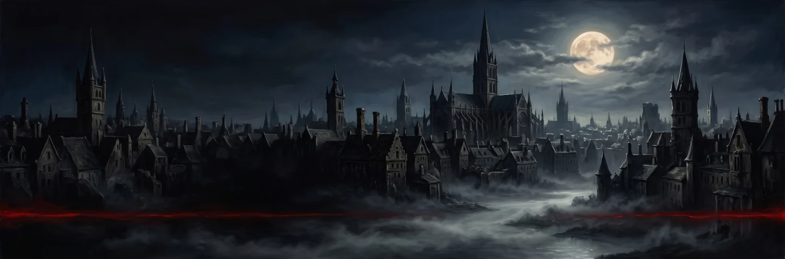
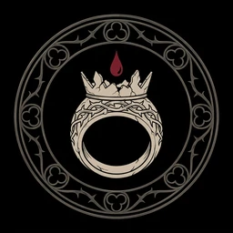
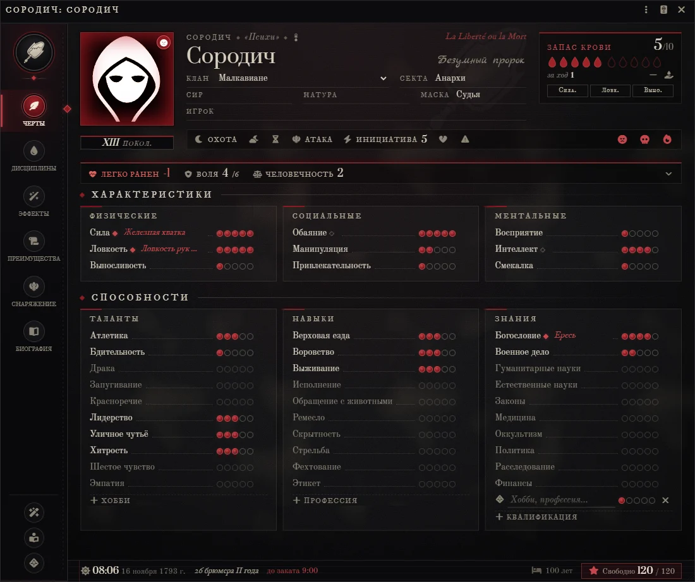
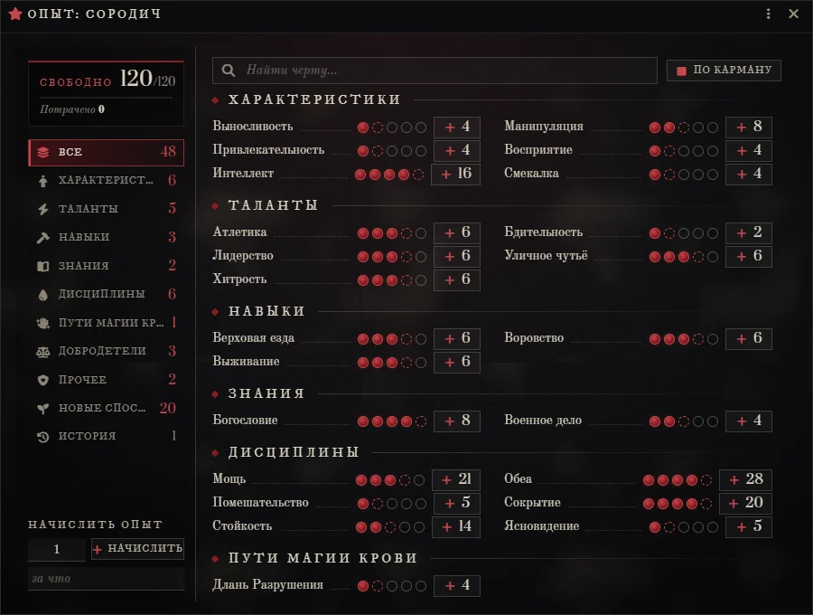
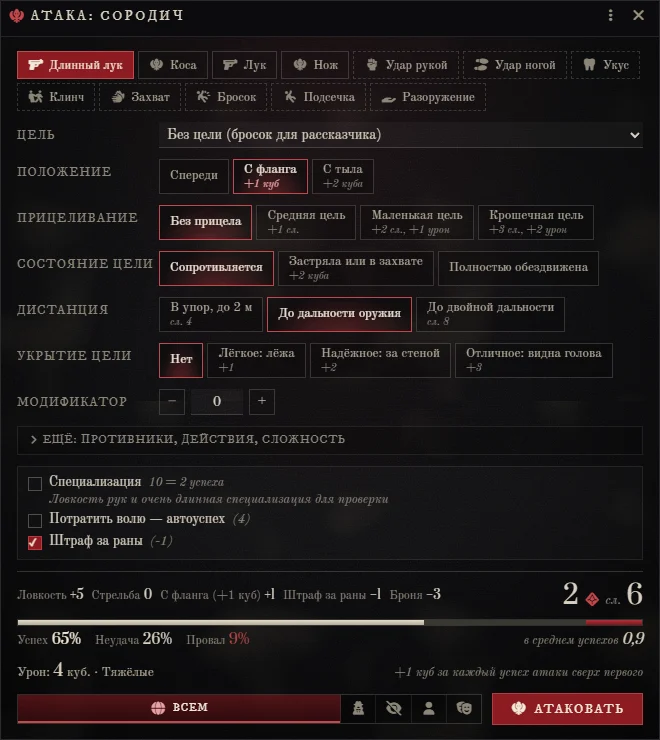
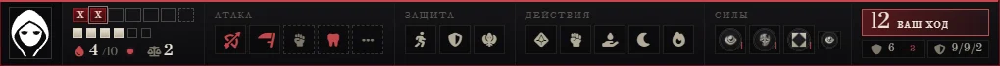

<p align="center"></p>
<p align="center"></p>

<h1 align="center">Vampire: The Masquerade 20th<br><sub>Kamen &amp; Shamil Edition</sub></h1>

<p align="center">
  <a href="https://github.com/erikhonder7-cpu/vtm20e-kamen-edition/releases/latest"></a>
  
  
  
  <a href="https://github.com/erikhonder7-cpu/vtm20e-kamen-edition/releases"></a>
</p>

<p align="center"><i>Система «Вампиров: Маскарада» 20-летнего издания для Foundry VTT — на русском, с автоматизацией правил V20<br>и оформлением «Liberté»: пергамент, сургуч, ночная синева и кровь на бумаге.</i></p>

---

## Установка

Ссылка на манифест:

```
https://github.com/erikhonder7-cpu/vtm20e-kamen-edition/releases/latest/download/system.json
```

1. В Foundry откройте **Game Systems → Install System**.
2. Вставьте ссылку в поле **Manifest URL** и нажмите **Install**.
3. Обновления Foundry будет предлагать сам.

[Последний релиз](https://github.com/erikhonder7-cpu/vtm20e-kamen-edition/releases/latest) · [архив вручную](https://github.com/erikhonder7-cpu/vtm20e-kamen-edition/releases/latest/download/vtm20e-kamen-edition.zip) · [история изменений](https://github.com/erikhonder7-cpu/vtm20e-kamen-edition/releases)

---

## Как это выглядит

<table>
  <tr>
    <td colspan="2"></td>
  </tr>
  <tr>
    <td width="55%"></td>
    <td width="45%"></td>
  </tr>
  <tr>
    <td colspan="2"></td>
  </tr>
</table>

---

## Возможности

### Персонажи
- **Сородич, гуль и ревенант, смертный, существо** — у каждого свой лист. Гуль переключается в ревенанта одного из 12 семейств, с семейными Дисциплинами и изъяном.
- **Мастер создания** по правилам V20: концепция и клан, 7/5/3, 13/9/5, Дисциплины, факты, Добродетели, достоинства и свободные пункты. Для гулей — 6/4/3, 11/7/4, 21 пункт.
- **Лист в стиле патента:** печать поколения, шкалы здоровья, воли и морали сворачиваются в строку, изъян клана, родословная сира.
- **Опыт:** окно покупки с ценой следующей точки и нехваткой, журнал. Рассказчик раздаёт опыт за сессию одним окном на всех.

### Броски и бой
- **Броски V20:** пул из двух черт, сложность, единицы, специализация, воля, раны, шансы успеха до броска. Кому виден бросок — значками.
- **Силы из книги:** у каждой силы готов пул, сложность и цена кровью или волей. Пути магии крови и ритуалы — по своим правилам.
- **Бой:** атака оружием и приёмами, защита, урон с прочностью и бронёй, торпор и Окончательная смерть. Статисты и толпы.
- **Проверки:** Ярость, Рётшрек и деградация — отдельной плашкой; узы крови, диаблери, опасности среды.
- **HUD** вместо панели макросов: шкалы, кровь с лимитом за ход, оружие, защита, избранные силы, инициатива и подсветка своего хода.

### Хроника
- **Охота и ночь простоя:** угодья, Слава и Домен, Стадо; Влияние, Богатство, Союзники и другие факты между сессиями.
- **Престация:** услуги на листе и реестр долгов хроники. **Паутина хроники** — сиры, узы и услуги на одной схеме. **Двор города** — должности Камарильи, Шабаша и анархов.
- **Календарь ночи:** часы хроники, восход и закат, фаза луны, журнал ночей. Силы и ритуалы гаснут по часам.
- **Карта города:** свои города, метки, зоны и домены, фишки персонажей, нарушения Маскарада, охота от карты. Нексус сцен с переходом на место на карте.

### Справочник внутри системы
| Компендий | Записей |
|---|---:|
| Правила V20 — 8 глав, включая «Гули и ревенанты» | 8 |
| Дисциплины — силы по уровням | 641 |
| Ритуалы | 574 |
| Достоинства и недостатки | 616 |
| Достоинства и недостатки гулей и ревенантов | 36 |
| Пути магии крови | 142 |
| Пути Просветления | 74 |
| Оружие и броня | 90 |
| Факты биографии | 40 |
| Психические расстройства | 37 |

Кланы, линии крови и антитрибу — в справочнике кланов с гербами. Контент Тёмных веков включается настройкой мира.

### Эпоха «Революционная Франция»
Настройка мира: способности эпохи (Верховая езда, Богословие, Военное дело), оружие 1789 года, ливры, су и денье с ассигнатами. Париж 1789 года с планом Мондаре 1790 года — отдельный модуль.

---

## Авторы

**Kamen & Shamil** — система, правила и оформление.

Шрифты Prata, Forum, Old Standard TT, IM Fell DW Pica, Marck Script — SIL Open Font License. Часть эмблем — [game-icons.net](https://game-icons.net/) (CC BY 3.0).

Vampire: The Masquerade — торговая марка Paradox Interactive. Это неофициальная фанатская система: тексты книг в неё не входят, только пересказ механики для игры.

Сборка, проверка и выпуск — в [docs/DEVELOPMENT.md](docs/DEVELOPMENT.md).
