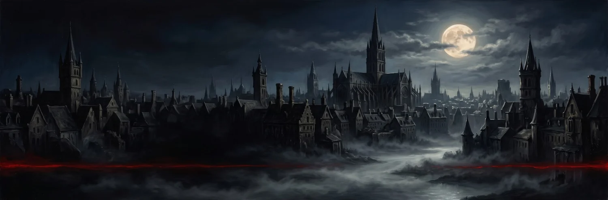
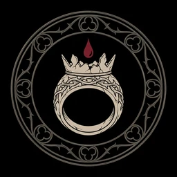
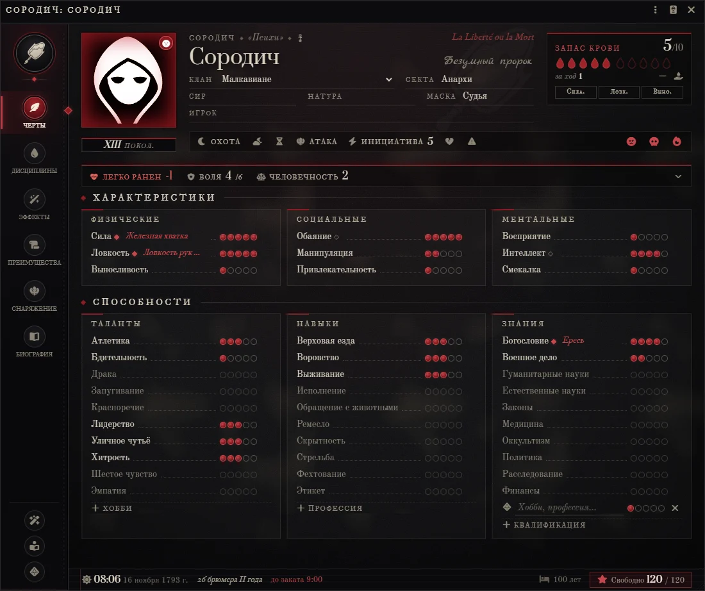
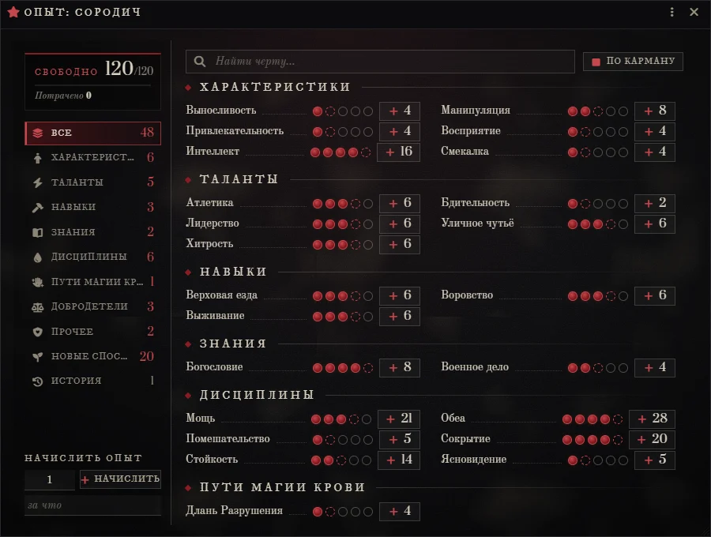
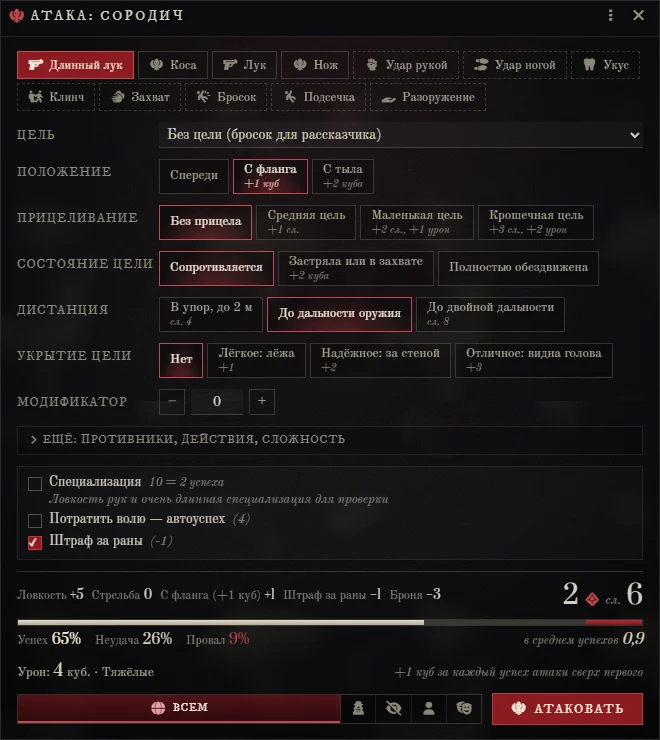
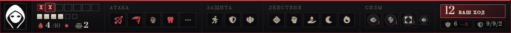

<p align="center"></p>
<p align="center"></p>

<h1 align="center">Vampire: The Masquerade 20th<br><sub>Kamen &amp; Shamil Edition</sub></h1>

<p align="center">
  <a href="https://github.com/erikhonder7-cpu/vtm20e-kamen-edition/releases/latest"></a>
  
  
  
  <a href="https://github.com/erikhonder7-cpu/vtm20e-kamen-edition/releases"></a>
</p>

<p align="center"><i>Система «Вампиров: Маскарада» 20-летнего издания для Foundry VTT — на русском, с автоматизацией правил V20<br>и оформлением «Liberté»: пергамент, сургуч, ночная синева и кровь на бумаге.<br>Ещё две линии — «Demon: The Fallen» (падшие, Привязанные к Земле и их слуги)<br>и «Hunter: The Reckoning» (охотники и Свидетели).</i></p>

---

## Установка

Ссылка на манифест:

```
https://github.com/erikhonder7-cpu/vtm20e-kamen-edition/releases/latest/download/system.json
```

1. В Foundry откройте **Game Systems → Install System**.
2. Вставьте ссылку в поле **Manifest URL** и нажмите **Install**.
3. Обновления Foundry будет предлагать сам.

[Последний релиз](https://github.com/erikhonder7-cpu/vtm20e-kamen-edition/releases/latest) · [архив вручную](https://github.com/erikhonder7-cpu/vtm20e-kamen-edition/releases/latest/download/vtm20e-kamen-edition.zip) · [история изменений](https://github.com/erikhonder7-cpu/vtm20e-kamen-edition/releases)

---

## Как это выглядит

<table>
  <tr>
    <td colspan="2"></td>
  </tr>
  <tr>
    <td width="55%"></td>
    <td width="45%"></td>
  </tr>
  <tr>
    <td colspan="2"></td>
  </tr>
</table>

---

## Возможности

### Персонажи
- **Сородич, гуль и ревенант, смертный, существо, падший, охотник** — у каждого свой лист и своя палитра: кровь у вампира, графит и серебро у смертного, свои цвета у падшего, огонь у Привязанного, янтарь и мел у охотника. Гуль переключается в ревенанта одного из 12 семейств, с семейными Дисциплинами и изъяном.
- **Мастер создания** по правилам V20: концепция и клан, 7/5/3, 13/9/5, Дисциплины, факты, Добродетели, достоинства и свободные пункты. Для гулей — 6/4/3, 11/7/4, 21 пункт. У падших, Привязанных и слуг — свои мастера (см. ниже).
- **Готовый смертный** становится гулем (домитор, витэ, Мощь 1, первая ступень уз) или слугой падшего — кнопкой на листе.
- **Инфернализм:** договоры с демонами на листе (форма сделки, условия, плата, злодеяние, рейтинг по Devil’s Due) и Вложения — 8 из V20 Rites of the Blood и 25 старых из книг Шабаша, с ценой применения.
- **Лист в стиле патента:** печать поколения, шкалы здоровья, воли и морали сворачиваются в строку, изъян клана, родословная сира.
- **Опыт:** окно покупки с ценой следующей точки и нехваткой, журнал. Рассказчик раздаёт опыт за сессию одним окном на всех.

### Броски и бой
- **Броски V20:** пул из двух черт, сложность, единицы, специализация, воля, раны, шансы успеха до броска. Кому виден бросок — значками.
- **Силы из книги:** у каждой силы готов пул, сложность и цена кровью или волей; текст — двумя разделами: **«Описание»** (что сила делает и как выглядит) и **«Система»** (бросок, цена, сроки, ограничения). Пути магии крови и ритуалы — по своим правилам.
- **Ритуалы по разделам:** описание, компоненты и проведение, эффект и механика, ограничения, «как снять» и прочее — каждый раздел своим блоком на листе ритуала, с книгой и страницей.
- **Бой:** атака оружием и приёмами, защита, урон с прочностью и бронёй, торпор и Окончательная смерть. Статисты и толпы.
- **Проверки:** Ярость, Рётшрек и деградация — отдельной плашкой; узы крови, диаблери, опасности среды.
- **HUD** вместо панели макросов: шкалы, кровь с лимитом за ход, оружие, защита, избранные силы, инициатива и подсветка своего хода.

### Хроника
- **Охота и ночь простоя:** угодья, Слава и Домен, Стадо; Влияние, Богатство, Союзники и другие факты между сессиями.
- **Престация:** услуги на листе и реестр долгов хроники. **Паутина хроники** — сиры, узы и услуги на одной схеме. **Двор города** — должности Камарильи, Шабаша и анархов.
- **Календарь ночи:** часы хроники, восход и закат, фаза луны, журнал ночей. Силы и ритуалы гаснут по часам.
- **Карта города:** свои города, метки, зоны и домены, фишки персонажей, нарушения Маскарада, охота от карты. Нексус сцен с переходом на место на карте.

### Падшие (Demon: The Fallen)
- **Падший:** мастер создания по Домам и Обликам, Вера и Мука с отдельной костью Муки (или по errata — настройка мира), грех и доброе дело, искупление опытом, врождённые способности, сбор Веры.
- **Знания и призывы:** 115 призывов пересказом, у каждого бросок; в карточке — сработавший эффект, обычный или высокой Муки.
- **Апокалиптическая форма:** черты Облика с числами, черты высокой Муки на выбор, конструктор формы из Players Guide; жетон на сцене в форме надевает выбранную игроком картинку и размер.
- **Привязанные к Земле:** свой мастер и огненный лист, Потребности вместо Добродетелей, реликварий, Тёмные Знания, форма без носителя за Веру каждый ход.
- **Слуги:** мастер слуги с шагом «Танец с Дьяволом» — хозяин, доля Веры, дары; договор записывается в лист падшего; Перебор, «Грех слуги». Дары с механикой: врождённые способности, черты формы, призывы, особые дары Домов — с ценой Волей и Мукой хозяину.
- **Тело-носитель:** гибель тела и экзорцизм, ход без тела, Бездна, новое тело — человек, слуга или предмет (и тогда падший становится Привязанным).
- **Привязанный:** завладение телом поклонника на 48 часов хроники, окно культа (ритуалы поклонения и почитания, культисты), беспамятство без Веры.
- **Журнал Муки:** что и за что её меняло; итог по Муке — в «Летописи сессии».
- **Ритуалы (в том числе бастионов) и реликвии** — предметами со своими листами; главы правил падших — в компендии.

### Охотники (Hunter: The Reckoning)
- **Охотник:** свой лист в янтарно-меловой гамме, кредо, Добродетели охоты (Милосердие, Прозрение, Рвение), Убеждённость, вкладка «Грани».
- **Грани** семи кредо: бросок, цена в Убеждённости, риск Убеждённостью; воззвание к Граням сцены; второе зрение.
- **Рост наделённых** (Players Guide, настройки мира): за опыт, деяниями, жертвой; Грани пятого уровня с обрядом.
- **Свидетели** — охотники без Граней: Убеждённость как рассудок, свои Добродетели и черты.
- **Мастер создания охотника** и **«Вера против падших»** — молитвы, экзорцизм, оружие веры, поиски.
- **Потерянные кредо** Players Guide — Отшельник (свой путь Граней «Одиночество» из Hunter Book: Hermit) и Скиталец.

### Дампиры (Accursed Heirs: Dhampirs, фанатское дополнение)
- **Дампир** — тип гуля «Дампир»: концепция (Соискатель, Самозванец, Предтеча, Отступник, Учёный, Бродяга, Признанный), Предок-вампир и его клан со слабостью дампира, своя кровь 10 (+ Древность), Дисциплины до 1.
- **Кровные права** — 14 обычных и 10 редких, по 3 точки, силы с бросками на вкладке Дисциплин; ритуалы Дриримантии.
- **Мастер создания дампира**: 18 свободных пунктов, шаг Кровных прав; свои черты и Дополнения — только дампиру.
- **«Безумие страсти»** — проверка в панели листа гулей и дампиров; у дампира — «Жажда крови» и без Ротшрека.
- Путь биотауматургии и три силы старейшин (Подобие жизни, Тоска Исиды, Вырвать проклятие вечности) — в справочнике Дисциплин.

### Справочник внутри системы
Компендии разложены по папкам линеек; библиотека персонажа показывает только своё — у вампира нет черт падших, у падшего — клановых и сектантских.

- **«Описание» и «Система»** у всех 1131 сил Дисциплин и у всех достоинств и недостатков. Чародейство Ассамитов (Dur-An-Ki), Akhu, Тауматургия V20, дополнительные традиции магии крови и 61 ритуал — по аудитам справочника.
- **Статус записи** в библиотеке: «Старая редакция», «Из другой традиции», «Требует сверки»; у сил старой редакции — пометка «Rev.».
- **«Обновить из справочника»** (меню **⋮** листа персонажа или предмета): силы, ритуалы и черты, перенесённые на лист раньше, получают текущие тексты; правленое вручную можно не трогать.

**Vampire: The Masquerade**

| Компендий | Записей |
|---|---:|
| Правила V20 — 9 глав, включая «Гули и ревенанты» и «Инфернализм» | 9 |
| Дисциплины — силы по уровням | 642 |
| Ритуалы — Тауматургия, Некромантия, Колдовство, Чародейство ассамитов и сетитов, Тёмная Тауматургия, Мистика Бездны | 712 |
| Достоинства и недостатки | 577 |
| Достоинства и недостатки гулей и ревенантов | 36 |
| Пути магии крови | 145 |
| Пути Просветления | 74 |
| Оружие, броня и снаряжение | 118 |
| Факты биографии | 32 |
| Психические расстройства | 37 |
| Инфернальные Вложения | 33 |

**Demon: The Fallen**

| Компендий | Записей |
|---|---:|
| Правила падших — главы | 15 |
| Знания демонов и призывы | 156 |
| Дома и фракции | 12 |
| Ритуалы падших | 75 |
| Реликвии падших | 97 |
| Достоинства и недостатки падших | 203 |
| Факты биографии падших | 20 |

**Hunter: The Reckoning**

| Компендий | Записей |
|---|---:|
| Правила охотников — главы | 2 |
| Черты охотников (наделённые и смертные Hunters Hunted II) | 221 |
| Дополнения охотников | 15 |

Кланы, линии крови и антитрибу — в справочнике кланов с гербами. Контент Тёмных веков включается настройкой мира.

### Эпоха «Революционная Франция»
Настройка мира: способности эпохи (Верховая езда, Богословие, Военное дело), оружие 1789 года, ливры, су и денье с ассигнатами. Париж 1789 года с планом Мондаре 1790 года — отдельный модуль.

---

## Авторы

**Kamen & Shamil** — система, правила и оформление.

Шрифты Prata, Forum, Old Standard TT, IM Fell DW Pica, Marck Script — SIL Open Font License. Часть эмблем — [game-icons.net](https://game-icons.net/) (CC BY 3.0).

Vampire: The Masquerade — торговая марка Paradox Interactive. Это неофициальная фанатская система: тексты книг в неё не входят, только пересказ механики для игры.

Сборка, проверка и выпуск — в [docs/DEVELOPMENT.md](docs/DEVELOPMENT.md).
